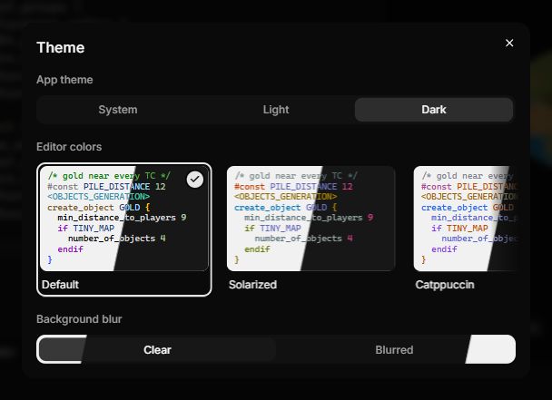

# Getting started

This page takes you from installing AoE2RMSIDE to your first generated map.

## Install

Download the installer or the portable ZIP from the
[releases page](https://github.com/aoe2control/AoE2RMSIDE/releases).

- **Installer:** installs AoE2RMSIDE for your Windows user. It also offers
  AoE2RMSIDE in Windows' **Open with** list for `.rms` and `.rms2` files, and
  adds **Open folder in AoE2RMSIDE** to the right-click menu of folders in
  Windows Explorer.
- **Portable ZIP:** unpack it into a folder of your choice and start the app
  from there. It does not register anything with Windows.

The app is not code-signed. If Windows SmartScreen warns about an unknown
publisher, choose **More info**, then **Run anyway**.

To make AoE2RMSIDE the app that opens `.rms` and `.rms2` files on
double-click, use **File → Choose Default App for RMS Files…** in an
installed build. It opens Windows' default apps settings, where you confirm
the choice yourself.

Uninstalling leaves your scripts and your deployed mods untouched. Your
AoE2RMSIDE settings stay too, in `%APPDATA%\@rmside\desktop`; delete that
folder if you want to remove them as well.

## The window

The window has three areas side by side:

- the **Explorer** on the left, with the files of the open folder;
- the **editor** in the middle;
- the **preview** on the right, where the generated map appears.

Below them, the bottom panel has the **Output** and **Problems** tabs. Output
shows each run as a group headed by the script name. While the group is open,
a small table under the name lists the seed, map size, players, duration and
result, and the run's messages follow, indented under it. A closed group fits
on one line (script, seed, size, players, time and result). Output also lists
deployments, live tests and anything that went wrong, in plain words. Each
message starts with an icon for its kind (error, warning or note) and shows
its time at the right. Errors and warnings can have a **Details** part for bug
reports, which opens in a small box under the message. Problems lists the
errors and warnings in your scripts in the same layout, grouped by file;
click a problem, or its line number at the right, to go there. Output does not
repeat them. Click the header of a group to open or close it.

The buttons next to the tabs show how many errors, warnings and notes there
are, and turn each kind on or off. Output shows all three by default. The
**Clear output** button next to them removes the messages and finished runs
from Output; a run that is still going keeps its messages.
Problems hides notes by default; turn them on to see small hints such as
names in the game's own files that count as 0. Both lists follow the newest
lines. Scroll up and they stay where you are, even while new lines arrive;
scroll back to the bottom, or press **Jump to Latest**, and they follow
again.

The button at the far left of the title bar collapses and expands the
Explorer. The layout button at the right end of the editor tab bar switches
between **Side by side**, **Preview behind editor**, where the map fills the
editor's area too and shows through the editor, and **Editor only** (see
[Workspace layouts](preview.md#workspace-layouts)). To resize the areas, drag
the gaps between them: while you point at one, a short bar shows on it and
follows the pointer. The separators work with the mouse only.
**View → Reset Layout** restores the default sizes and the **Side by side**
layout. **View → Theme…** sets the app theme and the editor colors (see
[Theme and editor colors](#theme-and-editor-colors)). The
**View** menu also holds **Show Live Generation Stages** for the preview,
**Check XS When Running a Map** for the
[XS start check](writing-scripts.md#xs-start-check), **Show Outline Row**,
**Show Inlay Hints** and **Lint Rules** for the editor, **Language…** for the
interface language, and **MCP…** for [AI apps](ai-apps.md).

## Theme and editor colors

**View → Theme…** opens the **Theme** panel. Every choice in it applies at
once, and AoE2RMSIDE remembers it the next time you start the app. Close the
panel with its **x** or **Escape**.

- **App theme** switches the whole window between **System**, **Light** and
  **Dark**. **System** follows the Windows setting for apps.
- **Editor colors** chooses the colors of the code in the editor:
  **Default**, **Solarized**, **Catppuccin**, **Gruvbox**, **Ayu** or **One**.
  Each card shows a short sample in the scheme's light colors on the left and
  its dark colors on the right. The editor uses the light half while the app
  is light and the dark half while it is dark, so one choice fits both.
  Scroll the row sideways to see every card.
- Click a card to choose it, or move between the cards with the arrow keys.
  The chosen card has a check mark.
- **Background blur** decides how the map looks through the preview's
  buttons, panels and menus, and through the editor where it lies over the
  map (**Preview behind editor**): **Clear** (the default) or **Blurred**.
  Point at either choice for a short explanation.

An editor color scheme changes only the colors of the text: commands, names,
numbers, comments and the colors of matching brackets, in RMS scripts, XS
files and map tests alike. The editor's background, the current line, the
selection and the rest of the window keep the colors of the app theme.
**Default** keeps the editor's original colors.

## Interface language

The menus, dialogs and messages of AoE2RMSIDE are available in 20 languages:
English, Deutsch, Français, Español (España), Español (México), Italiano,
Português (Brasil), Русский, Polski, Türkçe, 简体中文, 繁體中文, 日本語,
한국어, Tiếng Việt, Bahasa Melayu, हिन्दी, Українська, Čeština and
Nederlands.

When you start it for the first time, AoE2RMSIDE uses your Windows display
language, or English if it does not speak that language. To switch:

1. Choose **View → Language…**.
2. Open the list in the **Language** dialog and pick a language. Each
   language is listed by its own name. The first entry,
   **Windows display language**, follows Windows again.
3. Menus, dialogs and messages change at once. Close the dialog with its
   **x** or **Escape**.

AoE2RMSIDE remembers your choice. The code editor's own small menus, such as
its right-click menu and search box, change the next time you start the app;
the dialog says so when this applies. If you follow the Windows display
language and change it in Windows, AoE2RMSIDE follows at its next start.

Some things always stay as they are:

- RMS commands, constants and labels, and the code you write;
- the messages that come from checking and generating your scripts, such as
  the errors and warnings in Problems and the results of map tests. They stay
  in English, with their codes, so they read the same in every bug report;
- logs and support bundles.

These documentation pages are in English.

With a linked game folder, object and terrain names, for example in the
selection list, use the game's own names in your language when the game has
them, and English otherwise.

## Link your game folder (optional)

You can skip this step. Preview and map tests work without the game.

Steam installations of Age of Empires II: Definitive Edition are found
automatically: on startup, AoE2RMSIDE looks for the Steam installation and
links it. Installations from the **Xbox app** or the **Microsoft Store** can
be linked by selecting their game folder; they are untested. If you pick a
folder that does not hold a complete installation of the game, AoE2RMSIDE
tells you so.

When you link a folder yourself, Output shows a line like
`Using local AoE2DE 101.103.54800.0`.

To link a folder yourself:

1. Open the **Preview game version** menu on the right side of the bottom
   panel bar.
2. Choose **Select Game Folder**.
3. Pick the game's installation folder. In your Steam library this is
   `steamapps\common\AoE2DE`, the folder that contains `AoE2DE_s.exe`. For
   the Xbox app or the Microsoft Store, pick the folder the game is
   installed in, the one that contains `AoE2DE.exe`.

You can also use **Select Game Folder** in the Run options menu (the arrow
next to the Run button). While a folder is linked, **File → Open Game Folder**
opens it in Windows Explorer and **File → Unlink Game Folder** removes the
link.

AoE2RMSIDE only reads your game folder; it never changes the game's files.
Graphics from your own game installation are only read locally, and the
application never uploads them anywhere; only a picture you copy or save
yourself, or one that an AI app you allowed asks for, can contain them.

## Open your scripts

- **File → Open Folder…** (Ctrl+Shift+O), or the **Open Folder** button at
  the top of the Explorer, opens a folder in the Explorer. Use this for maps
  with include files, so the IDE can find them.
- **File → Open File…** (Ctrl+O), or the **Open File** button next to it,
  opens single files. You can also drag files from Windows Explorer onto the
  window. Opened files appear as tabs; the Explorer keeps showing the folder
  you opened (or stays empty), as in Visual Studio Code. Dragging a
  folder onto the window opens that folder. Files dropped onto the
  Explorer's folder tree are opened too; they are not copied into the folder.
- **File → New File** (Ctrl+N) creates a new `.rms` file with a small starter
  map.
- The arrow at the right end of the Explorer's top row (**Switch Folder**)
  lists your recent folders, the same ones as **File → Open Recent**, and
  **Open Folder…**. Choose one to open it instead of the open folder.

There is no project file. The IDE works on plain folders.

The Explorer lists your random map scripts, include and definition files,
map tests and XS scripts, and every folder. Files of other types, such as
text notes or images, are not listed. A folder with none of the listed files
anywhere inside it is shown slightly faded, so you can see at a glance that
nothing relevant is in it yet. Faded folders work like any other: open them,
create a new script or folder in them, rename or delete them. As soon as a
script exists inside, the folder and the folders above it show at full
strength again.

Right-click a file or folder for **Copy**, **Cut** and **Paste**, or press
**Ctrl+C**, **Ctrl+X** and **Ctrl+V** in the Explorer. Paste on a folder or
on the empty part of the Explorer. Cut and Paste moves the item. If the name
is taken, the copy gets a name as in Windows File Explorer, for example
`Map - Copy.rms`, then `Map - Copy (2).rms`. You can copy files and folders
from Windows File Explorer and paste them into the Explorer, and the other way
round. **F2** renames the selected item, and **Delete** deletes it.

The **Search files** box in the Explorer filters the folder tree as you type.
The tree keeps only the matching files and folders and the folders that
contain them, opens those folders for the search, and shows the matching part
of each name in bold. Upper and lower case do not matter. A search with `/`
matches paths inside the open folder, for example `maps/arabia`. **Up** and
**Down** move through the matches, **Enter** opens the file or opens or
closes the folder, and **Escape** clears the search. Once the box is empty,
the tree is back as you left it. While the box has focus, it widens over the
**Open File** and **Open Folder** buttons; they come back when you leave the
box. Clicking into the box again selects its text, so what you type replaces
the last search.

The same box also finds text inside your files: click **Search file
contents** at its end, or press **Ctrl+Shift+F** (**File → Find in
Files…**). To search one folder only, right-click it and choose **Find in
Files…**. See [Find in files](writing-scripts.md#find-in-files).

Delete in the Explorer asks before deleting. Press Enter to confirm or Escape
to cancel. Deleted items go to the Windows Recycle Bin. To delete permanently
instead, turn on **Edit → Skip Recycle Bin When Deleting**; the confirmation then
says the item will be deleted permanently and that this can't be undone.
Permanent deletion works only inside the open folder.

To start from one of the game's own maps, use
**File → Browse Installed Maps…** (needs a linked game folder). You can open a
map read-only, or press **Clone for Editing** to copy the map and the include
files next to it into a folder you choose. Next to the search box, three buttons
show or hide maps by origin: **Built-in maps** that come with the game,
**Local mod maps** from your own local mods, and **Subscribed mod maps** from
mods you subscribed to. All three are on at first; point at a button to see
how many of its maps match your search. Each map in the list shows its origin
too. The app remembers which origins you turned on.

## Your first map

When you start AoE2RMSIDE for the first time, the editor already shows a
short starter map. It is a small, complete map that works without the game,
and its first line points you to this documentation.

A short tour then explains the window, one part at a time. Each card lights
up one part: **Explorer**, **Editor**, **Generate a Map** (the Run button),
**Map Preview** once your first map appears, and **Output and Problems**.
**Got It** (or Escape) closes a card, and the next one follows when its part
is ready; **Skip Tour** ends the tour. It shows by itself only once;
**Help → Take the Tour** starts it again.

You can edit the starter right away. As soon as you change it, it becomes a
normal unsaved file; save it with **File → Save As…**. If you open another
file first, the untouched starter makes room for it.

**File → New File** creates the same starter map as a new unsaved file,
whenever you want a fresh start.

## Run it

Press the **Run** button (the play icon on the editor tab bar) or **F5**.

The map appears in the preview. Output shows the run as a group headed by the
script name, with its **Seed**, **Map size**, **Players**, **Duration** and
**Result** (for example `Generated`) in a small table below. Only the newest
run is open; older runs fold into one line, for example
`Untitled-1.rms · seed 1234 · 168×168 · 2 players · 0.4 s · Generated`.
Click the header of a run to open or close it.

If your script uses commands that none of the maps recorded from the game
used, the result is a note such as `3 commands not compared against the game`
instead of `Generated`. Open the run to see these commands listed below its
table; click one to go to the first place your script uses it. The map is
still generated; the note only tells you where the preview may differ from
the game. Commands the game ignores where they stand count as compared and
are not listed. See
[How AoE2RMSIDE is checked against the game](faq.md#how-aoe2rmside-is-checked-against-the-game).

Things to try next:

- Change a number in the script and run again.
- Open the **configuration menu** at the top of the preview and change the map size
  or the number of players.
- Open the Run options (the arrow next to Run) and change the **Seed**. The
  same seed with the same script, settings and game version always gives the
  same map.
- Turn on **Quality check** in the Run options: every Run is then followed by
  a check of many seeds for fairness and playability (see
  [Quality check](map-tests.md#quality-check)).

While a run is in progress, the Run button shows a spinner. When you point at
it, it turns into a Stop button. Click it or press F5 to stop the run.

## Next steps

- [Writing scripts](writing-scripts.md): file types, includes and editor help.
- [Preview](preview.md): settings, seeds and reading the map.
- [Map tests](map-tests.md): check many seeds automatically.
- [Deploying and live testing](deploying-and-live-testing.md): play your map
  in the game.
- [AI apps (MCP)](ai-apps.md): let an AI app work on your
  maps with you.

**Help → Documentation** in AoE2RMSIDE opens these pages.
