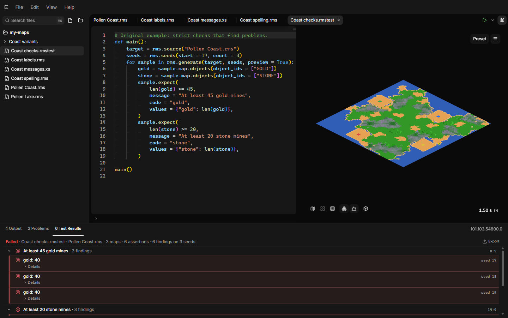

# Map tests

A random map looks different on every seed. A map can be fine on the ten
seeds you tried and still leave a player without gold on the eleventh.

A **map test** checks this for you. It generates your map for many seeds, one
after another, and runs your checks on every result. At the end you get a
list of the seeds where something was wrong. Click one and the preview shows
that same map.

Map tests run entirely inside AoE2RMSIDE. The game is not needed.

For the usual questions (does every player get the same resources, can
anything be trapped, is there room to build) you do not have to write a test
at all: turn on the [quality check](#quality-check), and every Run of your
map is followed by a ready-made set of checks over many seeds.

You do not need to be a programmer to write one. Map tests are small scripts
in a simple language, and most tests follow the same pattern. This page shows
that pattern step by step.

## Your first map test

### Create the file

Map tests are files with the extension `.rmstest`. To create one:

- right-click a folder in the Explorer and choose **Map-Test Script**, or
- use the **+** button next to a folder and choose **Map-Test Script**, or
- choose **File → New Map-Test Script**.

The new file contains a commented example. Lines starting with `#` are
comments, so the example does nothing until you remove the `#` signs.

### Write the test

Replace the content with this test. It generates your map for ten seeds and
checks that each map has at least eight gold mines:

```python
def main():
    target = rms.source()
    seeds = rms.seeds(start = 1, count = 10)

    for sample in rms.generate(target, seeds):
        gold = sample.map.objects(object_ids = ["GOLD"])
        sample.expect(
            len(gold) >= 8,
            message = "expected at least 8 gold mines",
            values = {"gold": len(gold)},
        )

main()
```

Line by line:

- `def main():` starts a block of code named `main`. Everything that belongs
  to it is indented by four spaces.
- `rms.source()` picks the map to test. Without a file name it uses the
  pinned map (see [below](#choose-the-map)).
- `rms.seeds(start = 1, count = 10)` makes the seeds 1, 2, 3 … 10.
- `rms.generate(...)` generates one map per seed. The `for` line then goes
  through the results one by one. Each result is called a **sample**.
- `sample.map.objects(object_ids = ["GOLD"])` returns every gold mine on that
  map. `GOLD` is the same name your RMS script uses.
- `sample.expect(...)` is the check. If the condition is false, it records a
  **finding** for this seed with your message and values.
- `main()` on the last line runs everything.

### Pin the map and run

1. Open the map you want to test and make its tab active.
2. In the Run options (the arrow next to the Run button), press
   **Pin executed script**.
3. Switch to your `.rmstest` tab and press **Run** (or F5).

The preview shows the latest finished map, up to twice a second. While the test runs, a progress
bar on the right side of the bottom panel bar shows **Testing**. Point at it
to see how many maps are done, for example "Testing maps, 30% (12 of 40
maps)". The total counts the maps the test has asked for so far, so it grows
when a later `rms.generate` asks for more. When the test ends, Output shows
the test as one line with its result (**Passed** or **Failed**), and a
**Test Results** tab opens in the bottom panel (see
[Read the results](#read-the-results)).



## The language in two minutes

Map tests use **Starlark**, a small language that looks like Python. If you
know some Python, you already know most of it. If not, these rules cover
nearly everything on this page:

- Indentation matters. Lines inside `def`, `for` and `if` are indented by
  four spaces.
- `#` starts a comment.
- Put your loops and `if` statements inside a function such as `main`, and
  call `main()` at the end. Starlark does not allow them at the top level of
  the file.
- Top-level constants are fine, for example `LIMIT = 20`.
- Lists are written `["GOLD", "STONE"]`. Text is written in quotes,
  `"like this"`.
- Compare values with `==` (equal), `!=` (not equal), `<`, `<=`, `>` and
  `>=`. Combine conditions with `and`, `or` and `not`. A comparison gives
  `True` or `False`.
- `len(x)` counts the items in a list. `min`, `max`, `range`, `sorted` and
  `abs` work as in Python.

A few Python features are not available: `import`, f-strings and `sum()`.
`load` loads only the [quality library](#use-the-quality-check-in-your-own-tests).
Use `print("gold:", count)` or `"gold: {}".format(count)` to build text.

The editor helps with map tests too: suggestions and documentation for the
`rms`, `sample` and `map` functions and, once you load them, the quality
library's, **Go to Definition** (F12) for your own functions and
names, **Go to Symbol** and **Format Document**. Suggestions stay closed
inside text in quotes and in comments. While you type the arguments of a
call, a small box shows the parameters of the call the cursor is in and
marks the one you are typing; this also works for `sample` and `map`
functions under the names your loop gives them, such as `m.objects(`. The
outline row below the code lists your functions (see
[Outline row](writing-scripts.md#outline-row)). The right-click menu lists
only what works in map tests.

Map tests cannot read or write files, use the network or pick random numbers.
All variation comes from the seeds, so a test gives the same result every time
you run it.

## Names of terrains and objects

Wherever a map test asks for terrains, objects or cliff types, you can use
the same names as in your RMS script: `"GOLD"`, `"FORAGE"`, `"TOWN_CENTER"`,
`"DEEP_WATER"`, `"CT_DESERT"` and so on. Write them in quotes, exactly as in
RMS. The names come from the game version selected for the preview.

Numbers work too, and you can mix both: `["GOLD", 102]`. A name AoE2RMSIDE
does not know stops the test with a message that names it.

The results a map test gets back, such as `tile.terrain` or
`obj.object_id`, are numbers. To compare them with a name, use `rms.id`:

```python
def main():
    for sample in rms.generate(rms.source(), rms.seeds(start = 1, count = 20)):
        corner = sample.map.tile(0, 0)
        sample.expect(
            corner.terrain != rms.id("DEEP_WATER"),
            message = "the corner of the map is deep water",
        )

main()
```

## Choose the map

`rms.source()` without a file name uses the pinned map. If nothing is pinned,
the test stops and asks you to pin a map or name one.

You can also name the map. The path is relative to the open folder (or, for a
test opened on its own from outside the open folder, to the test's own
folder):

```python
def main():
    target = rms.source("maps/arena.rms")
    seeds = rms.seeds(start = 1000, count = 200)
    samples = rms.generate(target, seeds, preview = False)
    print("generated", len(samples), "maps")

main()
```

The map size, players, game mode and game version come from the preview's
current settings, the same ones an ordinary Run uses. See
[Preview](preview.md#map-settings).

## Run many seeds

`rms.seeds` makes a list of seeds:

| Call | Seeds |
|---|---|
| `rms.seeds(start = 1)` | 1 |
| `rms.seeds(start = 1, count = 100)` | 1, 2, 3 … 100 |
| `rms.seeds(start = 1000, count = 50, step = 7)` | 1000, 1007, 1014 … |

You can also write a list of seeds yourself, for example `[5, 17, 42]`.

`rms.generate(target, seeds)` shows the latest finished map in the preview,
up to twice a second, and the last map of the run when it ends. With
`preview = False` the preview stays as it is, which is useful for long runs.

AoE2RMSIDE generates several maps at the same time. By default
(**Automatic**) it decides how many from your computer's processor cores,
free memory and the map size, and leaves room for the editor. To use a fixed
number instead, open the Run options (the arrow next to the Run button)
while the map test is the active file, and enter it under **Test cores** (it
takes the place of *Live test on run*). Leave it empty for Automatic, or enter a
number from 1 to your computer's processor count (at most 32); **Use Automatic**
empties the field again. Point at **Test cores** to see the range for your
computer. Work that is the same for every seed is
done once per batch, not once per map. Whatever the number, the results
always come back in seed order and are the same.

## Check something about each map

There are two ways to record a problem:

- `sample.expect(condition, message = "...")` records a finding **only when
  the condition is false**.
- `sample.report(message = "...")` **always** records a finding. Use it
  inside your own `if`.

Both take two optional extras:

- `values = {...}`: numbers or short texts to show with the finding, for
  example `{"gold": 5}`.
- `code = "..."`: a short label you choose, for example `"no-gold"`, to group
  findings of the same kind.

The following examples show common checks.

### Count objects

`objects` returns the objects with the names you give. `owner` limits the
result to one player; `0` is Gaia (nature).

```python
def main():
    for sample in rms.generate(rms.source(), rms.seeds(start = 1, count = 50)):
        m = sample.map
        centers = m.objects(object_ids = ["TOWN_CENTER"])
        sample.expect(len(centers) == 2, message = "expected two Town Centers")

        resources = m.objects(object_ids = ["GOLD", "STONE"])
        print("seed", sample.seed, "has", len(resources), "gold and stone objects")

main()
```

### Count terrain

`count_tiles` counts the tiles with any of the given terrains. This test
reports maps where more than 40% of the map is water:

```python
WATER_TERRAINS = ["WATER", "DEEP_WATER", "MED_WATER"]

def main():
    for sample in rms.generate(rms.source(), rms.seeds(start = 1, count = 50)):
        m = sample.map
        water = m.count_tiles(terrain_ids = WATER_TERRAINS)
        percent = water * 100 // (m.width * m.height)
        sample.expect(
            percent <= 40,
            message = "more than 40% of the map is water",
            values = {"water_percent": percent},
        )

main()
```

`//` divides and drops the remainder, so `percent` is a whole number.

### Measure distances

Objects store their position in 1/256 of a tile. Divide by 256 to get the
tile. This test checks that every Town Center has gold within 20 tiles:

```python
def tile_of(obj):
    # Object positions are stored in 1/256 steps of a tile.
    return (obj.x256 // 256, obj.y256 // 256)

def main():
    for sample in rms.generate(rms.source(), rms.seeds(start = 1, count = 50)):
        m = sample.map
        gold = m.objects(object_ids = ["GOLD"])
        for tc in m.objects(object_ids = ["TOWN_CENTER"]):
            tx, ty = tile_of(tc)
            nearest = None
            for mine in gold:
                gx, gy = tile_of(mine)
                d = m.chebyshev_distance(tx, ty, gx, gy)
                if nearest == None or d < nearest:
                    nearest = d
            sample.expect(
                nearest != None and nearest <= 20,
                message = "a player has no gold within 20 tiles",
                values = {"player": tc.owner, "nearest": nearest},
            )

main()
```

`chebyshev_distance` counts tiles like a king moves in chess: diagonal steps
count as one. `manhattan_distance` counts only straight steps, and
`squared_distance` gives the straight-line distance squared.

### Check that players are connected

`connected` tells you whether you can walk from one tile to another using
only the terrains you list. This test checks that every player can reach the
first player over land:

```python
WALKABLE = ["GRASS", "BEACH", "SHALLOW", "DIRT"]

def main():
    for sample in rms.generate(rms.source(), rms.seeds(start = 1, count = 50)):
        m = sample.map
        centers = m.objects(object_ids = ["TOWN_CENTER"])
        for other in centers[1:]:
            first = centers[0]
            linked = m.connected(
                first.x256 // 256, first.y256 // 256,
                other.x256 // 256, other.y256 // 256,
                terrain_ids = WALKABLE,
            )
            sample.expect(
                linked,
                message = "two players are not connected by land",
                values = {"player_a": first.owner, "player_b": other.owner},
            )

main()
```

List every walkable terrain your map uses. With terrain lists, `connected`
only looks at terrain and ignores objects. It moves in straight steps (up,
down, left, right).

To ask whether a villager could actually walk there, past trees, cliffs and
buildings, use `walkable = True` instead of a terrain list, or measure the
walking distance (see [Walking distances](#walking-distances)).

### Find separate areas

`components` splits the tiles with the given terrains into separate connected
areas, for example lakes or islands. Each area is a list of tiles:

```python
WATER_TERRAINS = ["WATER", "DEEP_WATER", "MED_WATER"]

def main():
    for sample in rms.generate(rms.source(), rms.seeds(start = 7)):
        m = sample.map
        lakes = m.components(terrain_ids = WATER_TERRAINS)
        print("seed", sample.seed, "has", len(lakes), "separate bodies of water")
        biggest = 0
        for lake in lakes:
            biggest = max(biggest, len(lake))
        print("largest one:", biggest, "tiles")
        for warning in sample.warnings:
            print("warning:", warning.code, warning.message)

main()
```

### Players and their starts

`sample.players` lists the players of the map, one per slot. You do not have
to find Town Centers yourself:

| Field | What it is |
|---|---|
| `slot` | The player's slot, 1 to 8. |
| `team` | The player's team, `0` for no team. |
| `start` | `"land"` when the player has a land (also on nomad maps), `"town_center"` when there is no land but a Town Center, `"none"` when the player has neither. |
| `start_x`, `start_y` | The start tile: where the player's land was placed, or the Town Center's tile. `None` without a start. |
| `town_center` | The player's first Town Center object, or `None`. |
| `land_zone` | The zone number of the player's land, like `tile.land_zone`. |
| `land_zone_shared` | `True` when another player's land has the same zone. |

```python
def main():
    for sample in rms.generate(rms.source(), rms.seeds(start = 1, count = 50)):
        for player in sample.players:
            sample.expect(
                player.start != "none",
                message = "a player has no start",
                values = {"player": player.slot},
            )

main()
```

### Walking distances

The distances above count tiles in a straight line, through forests, cliffs
and water. A **walking distance** goes around them, the way a villager would
walk:

- Walking moves to the 8 tiles around a tile, but never cuts across the
  corner of a blocked tile.
- Trees, cliffs, rocks, gold and stone mines, buildings, walls and gates
  block the way. Units, animals, relics and farms do not.
- Terrain blocks where a villager cannot walk, such as deep water.
- `open_for = 1` lets player 1 walk through their own buildings, walls and
  gates. Other players' and Gaia's still block.
- Distances are whole tiles. They are a close approximation of how far a
  villager walks, not the game's own paths.

`map.walk_distance(x1, y1, x2, y2)` gives the walking distance between two
tiles, or `None` when no way leads there.

To measure from one place to many targets, make a **distance field** once and
read it as often as you like. This test checks that the nearest gold is about
as far for every player:

```python
def main():
    seeds = rms.seeds(start = 1, count = 50)
    for sample in rms.generate(rms.source(), seeds, analyse = ["walk", "fields:starts"]):
        m = sample.map
        nearest = []
        for player in sample.players:
            if player.start == "none":
                continue
            field = m.distance_field(player, open_for = player.slot)
            gold = field.nearest(["GOLD"], count = 1)
            if len(gold) == 0:
                sample.report(
                    message = "a player cannot walk to any gold",
                    values = {"player": player.slot},
                )
            else:
                nearest.append(gold[0].distance)
        if len(nearest) > 1:
            sample.expect(
                max(nearest) - min(nearest) <= 3,
                message = "the nearest gold is much farther for some players",
                values = {"closest": min(nearest), "farthest": max(nearest)},
            )

main()
```

A walking query starts from, or goes to, a **place**. A place is:

- a tile, written `(x, y)`;
- an object from `map.objects(...)`;
- a player from `sample.players` (their Town Center, or their start tile
  when they have none; a player without a start cannot be a place);
- a list of up to 64 of these.

A distance field has these functions:

| Function | Returns |
|---|---|
| `field.at(x, y)` | The walking distance to a tile, or `None`. |
| `field.to(place)` | The walking distance to the nearest tile of a place, or `None`. |
| `field.reachable(place)` | `True` if walking reaches the place. |
| `field.nearest(object_ids, owner = None, count = 2, max_distance = None)` | Up to `count` (at most 64) nearest objects, nearest first. Each has `object` and `distance`. |
| `field.count_tiles(max_distance, ...)` | How many tiles within `max_distance` walking tiles match the filters. |

`max_distance = 30` on `distance_field` stops measuring 30 tiles out, which
is quicker on large maps.

`analyse = ["walk", "fields:starts"]` in `rms.generate` prepares the walking
data, and a distance field from each player's start with `open_for` set to
that player, while the maps generate. Your test then reads them right away.
The results are the same with or without it.

### Building space

Every tile filter (`tiles`, `count_tiles`, `boundaries`, `components`,
`connected`, and a distance field's `count_tiles`) also takes
`walkable = True` (or `False`) and `buildable = True` (or `False`). A
buildable tile can be walked on, has terrain a house can stand on, and has no
tree, rock, building or farm on it. This test compares the building space
within 16 tiles of each start:

```python
def main():
    for sample in rms.generate(rms.source(), rms.seeds(start = 1, count = 30)):
        m = sample.map
        space = []
        for player in sample.players:
            if player.start != "none":
                field = m.distance_field(player, open_for = player.slot)
                space.append(field.count_tiles(16, buildable = True))
        if len(space) > 1:
            sample.expect(
                min(space) * 100 >= max(space) * 90,
                message = "some players have much less building space",
                values = {"least": min(space), "most": max(space)},
            )

main()
```

### Narrow passages

`map.narrowest_passage(a, b)` finds the fewest walkable tiles that, if
something were built on them, would cut place `a` off from place `b`. With
`ring = 20` instead of `b`, it looks for a way out to every tile 20 tiles
away from `a`, for example to check that one building cannot close a base.

It returns:

- `width`: how many tiles would have to be blocked. `0` means the two places
  are not connected at all.
- `capped`: `True` when the width reached `limit` (16 by default, at most
  64). The way is at least that wide, and nothing else is measured.
- `routes`: how many separate narrow points the cut has.
- `passages`: up to 8 of them, narrowest first, each with its `width` and a
  tile `x`, `y` at the narrow point.

```python
def main():
    for sample in rms.generate(rms.source(), rms.seeds(start = 1, count = 20)):
        players = [p for p in sample.players if p.start != "none"]
        if len(players) < 2:
            continue
        cut = sample.map.narrowest_passage(players[0], players[1])
        if not cut.capped:
            sample.expect(
                cut.width > 3,
                message = "two players are joined only through a narrow passage",
                values = {"width": cut.width},
            )

main()
```

### Objects that found no place

`sample.placements()` lists every `create_object` that placed fewer groups
than it asked for, for example because no free spot was left. Each row has
the command's `line` and `column` in your map (`None` in an included file),
`object_id`, `player`, `groups_requested`, `groups_placed` and
`objects_created`. `sample.placements(short_only = False)` lists every
`create_object`.

```python
def main():
    for sample in rms.generate(rms.source(), rms.seeds(start = 1, count = 50)):
        for row in sample.placements():
            sample.report(
                message = "create_object placed fewer groups than it asked for",
                values = {"line": row.line, "asked": row.groups_requested, "placed": row.groups_placed},
            )

main()
```

### Seeds that fail to generate

Normally a seed whose map fails to generate stops the test. With
`failures = "record"`, the test goes on: that seed's sample has a `failure`
with `code`, `message` and `crash_id` (the known game crash it would hit, or
`None`), and no map. Check `sample.failure` before you read `sample.map`.
Findings cannot be recorded on a failed seed, so print it instead:

```python
def main():
    seeds = rms.seeds(start = 1, count = 100)
    for sample in rms.generate(rms.source(), seeds, failures = "record"):
        if sample.failure != None:
            print("seed", sample.seed, "failed:", sample.failure.code, sample.failure.message)
            continue
        sample.expect(len(sample.players) > 0, message = "no players")

main()
```

### XS scripts

If your map loads XS with `#includeXS`, a map test can check what that XS
does. Both functions below need a linked game folder, because they use the
game's `Constants.xs`.

`sample.xs_start()` runs the [XS start check](writing-scripts.md#xs-start-check)
on the sample's map, as the preview does, and returns:

| Field | What it is |
|---|---|
| `status` | `"completed"`, `"stopped"`, `"skipped_compile_errors"` or `"no_xs_files"` (the seed and lobby load no XS). |
| `files` | The XS files that ran. |
| `main_ran`, `rules_run`, `steps` | Whether `main()` ran, how many rules ran, and how many steps the run took. |
| `findings` | Runtime problems, each with `code`, `severity`, `message`, `file`, `line`, `column` and `arguments`. |
| `chat` | Chat lines, each with `text`, `call`, `file`, `line` and `column`. |
| `changes` | Changes per player, each with `player`, `kind` (such as `"resource"` or `"technology"`), `operation`, `target`, `amount`, `count`, `position`, `text`, `file` and `line`. |
| `stop` | `None`, or where the run stopped: `code`, `message`, `call`, `reason`, `function`, `file` and `line`. |

`rms.xs("path/file.xs", seed = 0)` opens an `.xs` file of your folder, and
`.call("name", ...)` runs one of its functions and returns the result. The
seed sets the XS random numbers.

```python
def main():
    for sample in rms.generate(rms.source(), rms.seeds(start = 1, count = 10)):
        start = sample.xs_start()
        sample.expect(
            start.status == "completed",
            message = "the XS start check did not finish",
            values = {"status": start.status},
        )
    print("bonus for 2 players:", rms.xs("xs/bonus.xs").call("bonusFor", 2))

main()
```

Like the preview's check, these results are not compared against the game.

## Other lobby settings

A map test uses the preview's settings unless you name others.
`rms.settings` describes a lobby setting:

| Argument | Values |
|---|---|
| `map_size` | `"tiny"` (120 tiles), `"small"` (144), `"medium"` (168), `"normal"` (200), `"large"` (220), `"huge"` (240) or `"ludicrous"` (480). |
| `players` | 1 to 8. |
| `teams` | A layout such as `"1v1"`, `"2v2"`, `"2v1v1"` or `"ffa"`, or a list of team numbers from 0 to 4, one per player. |

Whatever you leave out stays as in the preview's settings. Players the
preview does not have get the first free slot and colour and the first
player's civilization.

Pass one setting, or a list of up to 16, to `rms.generate`. Each setting gets
the same seeds, one setting after another. `sample.settings` tells you which
setting a sample used, and `sample.settings_index` is `None` for the
preview's own settings. A finding remembers its setting, so clicking it shows
that map in that setting (see [Read the results](#read-the-results)).

Other settings work in a test that loads the quality library: the `load`
line at the top of this example is enough.

```python
load("@rmside/quality", "quality_check")

SETTINGS = [
    rms.settings(map_size = "tiny", teams = "1v1"),
    rms.settings(map_size = "medium", teams = "2v2"),
    rms.settings(map_size = "huge", teams = "4v4"),
]

def main():
    seeds = rms.seeds(start = 1, count = 10)
    for sample in rms.generate(rms.source(), seeds, settings = SETTINGS, preview = False):
        sample.expect(
            len(sample.map.objects(object_ids = ["RELIC"])) >= len(sample.players),
            message = "fewer relics than players",
            values = {"size": sample.settings.map_size},
        )

main()
```

## Summaries and averages

Not every test needs findings. `print` writes to Output, so you can collect
numbers across all seeds and print a summary at the end:

```python
def main():
    seeds = rms.seeds(start = 1, count = 100)
    total = 0
    fewest = None
    for sample in rms.generate(rms.source(), seeds, preview = False):
        count = len(sample.map.objects(object_ids = ["GOLD"]))
        total += count
        if fewest == None or count < fewest:
            fewest = count
        if count == 0:
            sample.report(message = "this map has no gold at all", code = "no-gold")
    print("average gold mines per map:", total / len(seeds))
    print("fewest gold mines on one map:", fewest)

main()
```

## Read the results

When the test ends, the **Test Results** tab opens. The number on the tab is
the number of findings. The first line is a summary such as
`Failed · gold.rmstest · Arena.rms · 50 maps · 100 assertions · 3 findings on 2 seeds`:

- the result: **Passed** when the test ran to the end and recorded no
  finding, **Failed** when it recorded at least one;
- the test and, when every finding is on the same map, that map;
- **maps**: how many maps were generated;
- **assertions**: how many times `expect` or `report` was called;
- **findings**: how many problems were recorded, and on how many seeds.

If the game would crash on some seeds of the map, a **Game crashes** group
comes first. It counts the maps the game crashes on and lists each known
crash with its cause, its fix and the seeds it hits. Those seeds generate no
map, and the test goes on with the next seed.

Below the summary, findings are grouped by the check that recorded them: one
group per `expect` or `report` line of your test, in the order of your test.
The list uses the same layout as Output. A group's header shows the check's
message, how many findings it has, and at the right the check's line in your
test, such as `21:13`. If the message is different for each finding (for
example because it contains the seed), the group is called "Check on line 12"
and each finding shows its own message.

The findings are indented under their check. Each one shows the values you
recorded with it, for example `player: 1 · gold_nearby: 4`, and its seed at
the right, such as `seed 17`. **Details** under a finding opens a small box
with your `code`, the line of your test, the map file and the values in full.
When the same finding is recorded several times on one seed (for example once
per player), it is shown once with a count such as `×2`.

- **Click a finding** (or its seed) to generate that same map in the preview.
  This works as long as the test script is open and neither the test, the
  map nor the game version has changed since the run. If it cannot, Output
  says why. The finding's seed becomes the Run menu's seed and the seed lock
  closes, so the next **Run**, live preview and quality check use that seed
  until you open the lock.
- If the finding was made with other lobby settings than the Run menu has
  (another setting of the test, or players with a Random civilization, which
  a test fixes once per run), its settings go into the temporary
  configuration **Test Config**. Its button above the map has a dotted
  outline, and it is neither stored nor listed. **Back to** with your
  configuration's name, beside it, returns to your own configuration as it
  was, with its seed and lock; choosing a configuration from the list ends
  it too. A finding made with the Run menu's own settings changes only the
  seed.
- **Click the line number** at the right of a check's header to go to that
  line of your test.
- Click a check's header to collapse or expand it. A check with many
  findings shows the first 100; **Show 100 More** shows the next ones.

If the test stops early, it records no new results. This happens when the
test script has a mistake, a map fails to generate, a limit is reached, or you
press Stop. Problems shows the line of your test where it stopped, and Output
explains what happened. If the Test Results tab was already open, it keeps the
results of the run before and says so at the top ("The latest run stopped with
an error" or "The latest run was stopped"). While a new run is going, it says
"A map test is running", with the maps tested so far once the test has asked
for maps, for example "A map test is running · 12 of 40 maps".

Use `print` freely while you write a test. Everything printed appears under
the test's line in Output, in a monospace font, in the order your test printed
it. Output keeps the latest 200 lines of each run and says how many earlier
lines it no longer shows.

### Save and share a report

**Export** in the Test Results tab saves the results as a JSON file. The
report contains no script text, no generated maps and no full file paths.

**File → Import Test Report…** opens a saved report, for example one a friend
sent you. The menu item is only there while no Test Results tab is open. An
imported report says so at the top. To show a finding's map from it, open the
same test with the same map and game version.

The Test Results tab closes when you start an ordinary map Run.

## Quality check

The quality check is a ready-made map test. It generates your map on many
seeds and compares what every player gets: start resources, distances,
neutral resources, wood, building space, trapped objects, paths between
players, water, narrow passages, and how varied and natural the map looks.
You do not write anything for it.

### Turn it on

Open the Run options (the arrow next to the Run button). The **Quality
check** row sits below the Seed row:

- **Quality check** turns the check on or off.
- **Seeds to check**: how many seeds to check, from 1 to 4,096. The default
  is 20.
- **Cases** (the list icon) chooses what the check looks at. **Generation**
  always runs.

While the check is on, every **Run** and **Run on save** of a saved `.rms`
map is followed by a quality check once the preview shows the map. It checks
the seeds from the Seed field onwards (with seed 100 and 20 seeds: 100 to
119) with the current map size, players and lobby settings. **Run on edit**
never starts one, and a new Run replaces a check that has not started yet.

**Other lobby settings** (the layers icon between the seed count and
**Cases**) also checks Tiny 1v1, Medium 2v2 and Huge 4v4, ten seeds each,
besides your current settings. It is off by default; a setting equal to
yours is checked only once.

### What it checks

| Case | What it looks at | At most |
|---|---|---|
| Generation | Seeds that fail or would crash the game, players without a start, and `create_object` commands that place too little or unevenly. | Failure |
| Start resources | Gold, stone, food, predators and own objects near each start, compared between players. | Failure |
| Resource distances | Walking distance from each start to its nearest resources, and which side they are on. | Failure |
| Shared resources | How neutral gold, stone, relics and hunt split between players, and who is nearest the centre. | Failure |
| Wood | Trees and large woodlines near each start. | Failure |
| Trapped resources | Own objects and nearby resources that the player's villagers cannot reach, and animals the player's own buildings close in. | Failure |
| Paths | Whether players can walk to each other, and walking distances to opponents and teammates. | Failure |
| Building space | Buildable land near each start and the tiles it takes to wall a base. | Failure |
| Hills | High ground near each start towards the nearest opponent. | Warning |
| Water | Shores, shore fish, islands, and resources open to ships. Skipped on land maps. | Failure |
| Spacing | Resources placed right next to each other or to a Town Center. | Warning |
| Chokepoints | Narrow passages between opponents, and gold or stone one building could cut off. | Warning |
| Variation | How much forests, starts and object counts change between seeds. | Advice |
| Looks | Beaches, bare areas, one-terrain land, round shapes and uneven map edges. | Advice |

Each finding is a **failure**, a **warning** or **advice**:

- A failure means one player is worse off than another, or a player's own
  object cannot be used, such as a start gold mine no villager can reach. A
  player with no start at all (a 1v1 map played with 4 players) is one
  failure, and the cases that compare players leave that map out.
- A warning is something to look at, for example resources that are closed
  in for every player alike, wolves near a start, or sheep that a player's
  own starting buildings close in.
- Advice points at things worth a look, mostly variety and looks, such as
  forests that are the same on every seed.

A player can walk through their own walls and buildings. Distances are
walking distances (see [Walking distances](#walking-distances)), so a
difference of a tile or two is normal.

The limits are set on well-regarded community maps and on official maps:
maps that reviewers rated well pass at Tiny 1v1 without failures. Some of
the default limits:

| Check | Warning | Failure |
|---|---|---|
| Own gold, stone, berries, hunt or sheep, difference between players | any | more than 3 |
| Walking distance to the nearest gold, stone, berries or hunt, difference | more than 4 tiles | more than 12 tiles |
| Trees within 20 tiles, difference | more than 25 % | |
| No large woodline and less than half the wood of another player | | always |
| Buildable land within 16 tiles, difference | more than 15 % | more than 40 % |

A quality check reports **Passed**, **Warnings** or **Failed**; only
failures make it fail.

### Read the results

A quality check reports in three places:

- **Output** shows one group per check, headed by the map, its time and the
  result (**Passed**, **Warnings** or **Failed**). Each finding names its
  case and what it found, then on how many maps, the median, the 95th
  percentile and the highest value, and the worst seeds, for example
  "Shared resources: Neutral stone is split unevenly between players" and
  "21 of 29 maps · median 8, 95th percentile 8, highest 9 piles · worst
  seeds 15, 20, 4". **Passed** lists the cases that found nothing.
- **Problems** lists failures as errors and warnings as warnings, under the
  map.
- **Test Results** groups the findings by case. Each finding ends in its
  worst seeds; click a seed to show that map in the preview. A seed the game
  would crash on has no map to show.

The median and the 95th percentile matter more than the average: players
notice a problem that shows on one seed in ten.

### Use the quality check in your own tests

The quality check is a library that comes with AoE2RMSIDE. Your own map test
can load it, for example to use other limits, check other seeds or settings,
or run one case on your own samples:

```python
load("@rmside/quality", "quality_check")

def main():
    result = quality_check(
        seeds = rms.seeds(start = 1, count = 50),
        thresholds = {"wood/wood-near-start": {"warning": 15}},
    )
    print(result.text)

main()
```

`load` must come first in the file and can only load `"@rmside/quality"`.
AoE2RMSIDE turns on everything the library needs for a test that loads it.

`quality_check(target = None, seeds = None, settings = None, cases = None, thresholds = None)`:

| Argument | Values |
|---|---|
| `target` | The map, given as `rms.source("maps/arena.rms")`; the pinned map when left out. |
| `seeds` | A list of seeds; 1 to 20 when left out. |
| `settings` | A setting from `rms.settings`, or a list of them; the preview's own when left out. |
| `cases` | A list of case names, such as `["wood", "paths"]`; all cases when left out. `"generation"` always runs. |
| `thresholds` | Other limits (see below). |

It runs once per test and returns:

| Field | What it is |
|---|---|
| `result` | `"passed"`, `"warnings"` or `"failed"`. |
| `counts` | `failures`, `warnings` and `advice`. |
| `items` | The findings, failures first. Each has `case`, `code`, `level`, `message`, `bad` (on how many maps), `of` (of how many measured), `metric` (`label`, `unit`, `p5`, `p50`, `p95`, `max`, or `None`) and up to three `worst` maps, each with `seed`, `settings_index`, `value`, `players` (one value per player) and `tile`. |
| `passed` | The cases that found nothing. |
| `skipped` | The cases that did not run, each with a `reason`. |
| `omitted_items` | How many findings were left out to keep the result short. |
| `samples`, `failed_samples` | How many maps were checked, and how many did not generate. |
| `text` | A summary of at most 40 lines. |

The case names in `cases` are `generation`, `start-resources`,
`resource-distances`, `shared-resources`, `wood`, `trapped`, `paths`,
`building-space`, `hills`, `water`, `spacing`, `chokepoints`, `variation`
and `looks`. Each case also has its own function, named with underscores
(`start_resources`, `building_space`, ...), that runs on samples you
generated yourself and returns its `case`, `skipped` and `items`:

```python
load("@rmside/quality", "wood")

def main():
    samples = rms.generate(rms.source(), rms.seeds(start = 1, count = 20), preview = False)
    for item in wood(samples).items:
        print(item.level, item.message, item.bad, "of", item.of)

main()
```

**Limits.** `DEFAULT_THRESHOLDS` holds every limit, named `"case/code"`,
for example `"wood/wood-near-start": {"warning": 25}`. In `thresholds` you
give only the numbers you want to change. `None` removes a level, for
example `{"building-space/building-space": {"failure": None}}` keeps only
its warning. A level above what a case can report, an unknown name or an
unknown code stops the test with a message. `CASES` maps each case name to
its function, and `VERSION` names the library's release.

The worst maps of each finding are also recorded as findings of your test,
with the code `case/code` and the values `value`, `tile_x` and `tile_y`
(the tile the finding is about), at the line that called the library. Only
failures make the test fail; warnings and advice keep their findings and the
test passes.

## Limits

Map tests have fixed limits so a test cannot freeze your computer:

| Limit | Value |
|---|---|
| Maps per run | 4,096 |
| Lobby settings per run, besides the preview's | 16 |
| Places per walking query | 64 |
| Findings per run | 4,096 |
| Values per finding | 32 |
| Run time | 10 minutes |
| Output | 10,000 lines |
| Test script size | 1 MiB |

The memory a test may use depends on your computer, up to a fixed maximum.
Very large batches of the largest maps can still reach it. The test then
stops and asks you to generate fewer seeds per run.

The script itself also has a step limit. Looping over every tile of every
map in your own code can reach it. Prefer the built-in functions such as
`count_tiles`, `components` and `connected`, which do that work much faster.

## Function reference

### `rms`

| Function | Returns |
|---|---|
| `rms.source()` | The pinned map. |
| `rms.source("path/map.rms")` | The named `.rms` or `.rms2` file, relative to the open folder (or the test's own folder when the test is outside it). |
| `rms.seeds(start, count = 1, step = 1)` | A list of seeds. |
| `rms.generate(target, seeds, preview = True, settings = None, failures = "stop", analyse = None)` | One sample per seed, in seed order; with several `settings`, one setting after another. `failures = "record"` keeps failed seeds as samples. `analyse = ["walk", "fields:starts"]` prepares walking data. |
| `rms.settings(map_size = None, players = None, teams = None)` | A lobby setting, with `map_size`, `width`, `height` and `players` (each with `slot`, `team`, `civilization_id` and `color`). |
| `rms.id("NAME")` | The number behind a game constant name, such as `rms.id("GOLD")`. |
| `rms.xs("path/file.xs", seed = 0)` | An XS file of the open folder; `.call("name", ...)` runs one of its functions (see [XS scripts](#xs-scripts)). |

Also available: `print(...)`, which writes to Output, and `fail("message")`,
which stops the test with an error.

### Sample

| Name | What it is |
|---|---|
| `sample.seed` | The seed of this map. |
| `sample.map` | The generated map; `None` for a failed seed. |
| `sample.expect(condition, message, values = None, code = None)` | Records a finding if `condition` is false. |
| `sample.report(message, values = None, code = None)` | Always records a finding. |
| `sample.players` | The players by slot (see [Players and their starts](#players-and-their-starts)). |
| `sample.placements(short_only = True)` | The `create_object` commands that placed fewer groups than they asked for; all of them with `short_only = False`. |
| `sample.failure` | `None`, or for a failed seed kept with `failures = "record"`, its `code`, `message` and `crash_id`. |
| `sample.settings` | The lobby setting this map used, like `rms.settings` returns it. |
| `sample.settings_index` | `None` for the preview's settings, otherwise the number of the other setting (from 0, in the order the test first used them). |
| `sample.xs_start()` | Runs the XS start check on this map (see [XS scripts](#xs-scripts)). |
| `sample.warnings` | Warnings from generating this map; each has `code` and `message`. |
| `sample.metrics` | `tile_count`, `object_count` and other counts for this map. |
| `sample.map_hash`, `sample.request_hash` | Fingerprints that identify this map and request. |

### Map

Tile coordinates start at `0`. `x` runs from `0` to `width - 1`, `y` from `0`
to `height - 1`.

| Function | Returns |
|---|---|
| `map.width`, `map.height` | Map size in tiles. |
| `map.tile(x, y)` | One tile. |
| `map.tiles(...)` | The tiles that match the filters. |
| `map.count_tiles(...)` | How many tiles match the filters. |
| `map.objects(object_ids = None, owner = None)` | Objects, optionally only these objects or this owner. Includes walls. |
| `map.walls(object_ids = None, owner = None)` | Only wall objects. |
| `map.neighbors(x, y, diagonal = False)` | The 4 (or 8) tiles around a tile. |
| `map.connected(x1, y1, x2, y2, ...)` | `True` if the two tiles are linked through tiles that match the filters. |
| `map.components(...)` | Separate connected areas of matching tiles, each a list of tiles. |
| `map.boundaries(...)` | Matching tiles at the edge of their area or of the map. |
| `map.manhattan_distance(x1, y1, x2, y2)` | Straight steps between two tiles. |
| `map.chebyshev_distance(x1, y1, x2, y2)` | Steps between two tiles when diagonal steps count as one. |
| `map.squared_distance(x1, y1, x2, y2)` | Straight-line distance, squared. |
| `map.cliffs(cliff_types = None)` | Cliff pieces, each with `from_x`, `from_y`, `to_x`, `to_y` and `cliff_type`. |
| `map.connections(kinds = None)` | Connections, each with `start_x`, `start_y`, `end_x`, `end_y` and `kind` (`"land"`, `"water"` or `"road"`). |
| `map.walk_distance(x1, y1, x2, y2, open_for = None)` | The walking distance between two tiles in whole tiles, or `None`. |
| `map.distance_field(sources, open_for = None, max_distance = None)` | Walking distances from one or more places to every tile (see [Walking distances](#walking-distances)). |
| `map.narrowest_passage(a, b = None, ring = None, open_for = None, limit = 16)` | The narrowest way between two places (see [Narrow passages](#narrow-passages)). |
| `map.walk_hash()` | A fingerprint of the map's walking data. |

Where a function takes `...`, you can filter by `terrain_ids`,
`land_zone_ids`, `terrain_zone_ids` and `layer_ids`. Each filter is a list. A
tile matches if it matches every filter you give. `walkable = True` keeps only
tiles a villager can walk on and `buildable = True` only tiles a house could
stand on; `False` keeps the others.

`object_ids`, `terrain_ids` and `cliff_types` accept names and numbers.
`land_zone_ids`, `terrain_zone_ids`, `layer_ids` and `owner` take numbers.

### Quality library

Load these names with `load("@rmside/quality", "name", ...)`.

| Name | What it is |
|---|---|
| `quality_check(target = None, seeds = None, settings = None, cases = None, thresholds = None)` | Runs the quality check (see [Use the quality check in your own tests](#use-the-quality-check-in-your-own-tests)). |
| `generation`, `start_resources`, `resource_distances`, `shared_resources`, `wood`, `trapped`, `paths`, `building_space`, `hills`, `water`, `spacing`, `chokepoints`, `variation`, `looks` | One case each, called as `wood(samples, thresholds = None)`. |
| `CASES` | Each case name with its function. |
| `DEFAULT_THRESHOLDS` | Every limit, named `"case/code"`. |
| `VERSION` | The library's release, as text. |

### Tile and object fields

| Record | Fields |
|---|---|
| Tile | `x`, `y`, `terrain`, `elevation`; advanced: `land_zone`, `terrain_zone`, `layer`, `flags` |
| Object | `object_id`, `owner`, `x256`, `y256`, `is_wall`; advanced: `facet`, `footprint_width256`, `footprint_height256`, `resource_type`, `resource_delta`, `resource_quantity_f32_bits`, `status`, `death_state`, `data_status`, `selection_flags`, `behavior_flags` |

All fields are numbers, except `is_wall` (`True` or `False`). `x256` and
`y256` are positions in 1/256 of a tile. The advanced fields are low-level
values the game stores for each tile and object; most tests do not need them.

The editor completes these names and shows a short description when you
point at them.
