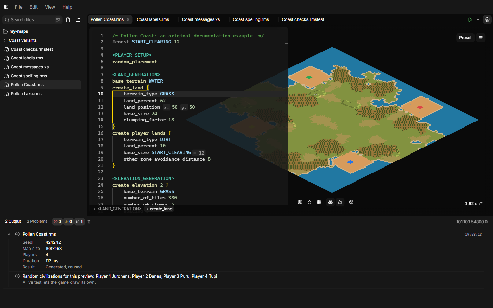
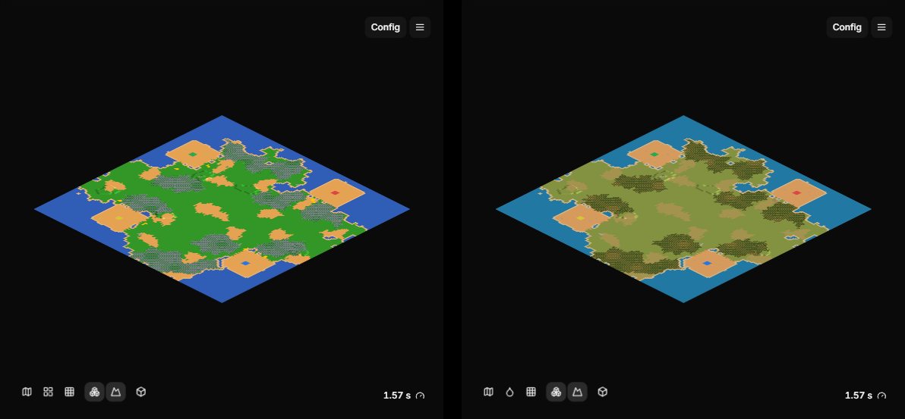
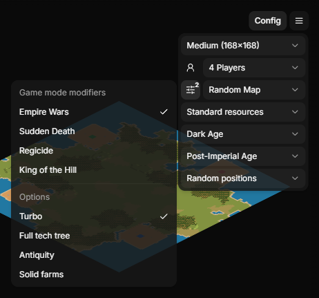
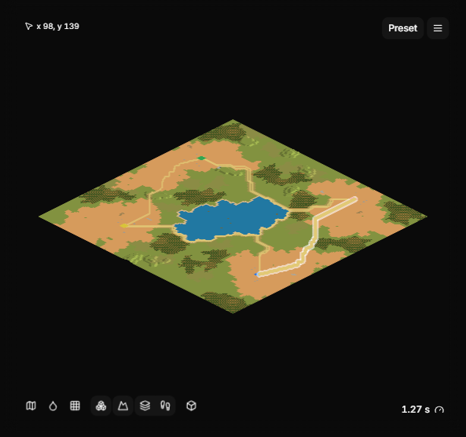
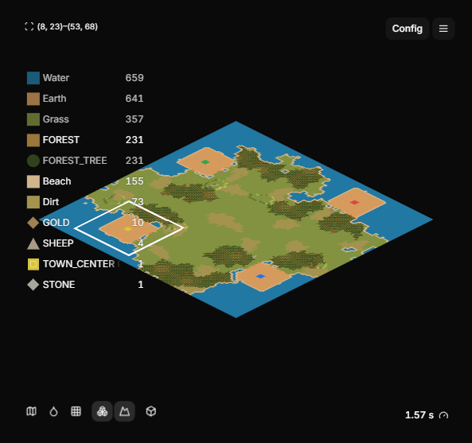
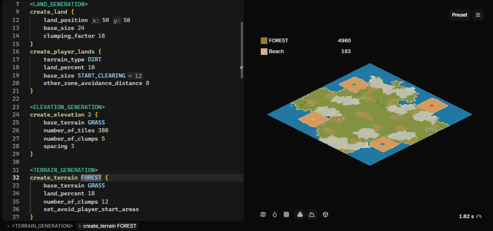

# Preview

When you press **Run**, AoE2RMSIDE generates the map from your script and
shows it in the preview next to the code, or behind it (see
[Workspace layouts](#workspace-layouts)). The map is generated by
AoE2RMSIDE's own RMS engine. The game does not need to be installed or
running.

The preview shows the map as it is when a game starts: terrain, elevation,
cliffs, objects and player starting positions.

## Workspace layouts

The layout button at the right end of the editor tab bar decides how the
editor and the preview share the window. Each click moves to the next layout,
and the button's tooltip names the current one:

- **Side by side** (the default): the editor and the preview next to each
  other.
- **Preview behind editor**: the map fills the editor's area too and is drawn
  behind the editor. The editor's background is partly transparent, so the
  map shows through it; the code, the selection and the editor's pop-ups stay
  solid.
- **Editor only**: the preview is hidden and the editor takes its place.

AoE2RMSIDE remembers the layout, also after a restart.

In **Preview behind editor**, the code starts hidden, so you see the whole
map. Click the active editor tab to hide the code, and click any tab to show
it again with that tab active (Enter or Space on a tab works too). Opening a
file, or going to a line from Problems, a search result or the selection
list, also shows the code. AoE2RMSIDE remembers for this layout whether the
code shows. **View → Reset Layout** returns to **Side by side** and hides the
code behind the map again for the next time you choose this layout.

While the code shows, clicking, selecting and typing over it go to the
editor, and the map pans and zooms in the part beside it. The map tools and
the other buttons on the map stay in that part too. The separator between
the code and the map moves the editor's edge over the map.

- While the code shows, the map is centered in the part beside the code.
  While it is hidden, the map is centered in the whole preview.
- `0` or Home fits the map to the whole preview, the part behind the editor
  included.
- Switching between **Side by side** and **Preview behind editor** keeps the
  map where it is on screen. With the code hidden, a centered map glides to
  its new center.

To blur the map behind the editor and behind the preview's buttons, panels
and menus, set **Background blur** to **Blurred** in the Theme panel (see
[Theme and editor colors](getting-started.md#theme-and-editor-colors)).

## Perspective and look

The map tools at the bottom left of the preview start with three buttons that
decide how the map is drawn: **Perspective**, **Look** and **Tile grid**.
AoE2RMSIDE remembers all three, also after a restart. Point at any map tool
to see its tooltip at once; after a click, the tooltip names the new state.

**Perspective** switches between two views:

- **Top-down view** looks straight down on the map.
- **Diamond view** is flatter, like the game's own view and minimap.

**Look** moves to the next look each time you click it. Its tooltip names the
current look.

- **Minimap colors** draws every terrain in the color the game's own minimap
  uses, and objects as small markers. The game gives many terrains the same
  minimap color: for example, dry grass and snow use the same green as grass,
  and every forest uses the same dark green.
- **Texture colors** draws every terrain in the average color of its game
  texture, and trees, gold, stone and other nature objects in the average
  color of their graphic. Player objects keep their player color. The colors
  ship with AoE2RMSIDE, so this look works without the game.

Some things look different in each look:

- **Cliffs** are wide dark brown bands in Minimap colors, so they stand out
  on every terrain, and bands in the average color of their rock in Texture
  colors.
- **Forests** show every tree. Each tree is a small marker, so the ground
  color shows between the trees when you zoom out.
- In **Diamond view**, object markers are squeezed to the flat diamond shape
  of the tiles.

In both looks, the shape of an object marker shows what the object is:

| Object | Marker |
|---|---|
| Buildings and gates | A square the size of the building, with a light inner line |
| Farms | A lighter square the size of the farm |
| Units | A small circle |
| Animals | A triangle |
| Gold and stone | A diamond |
| Berry bushes and fish | A small cluster of dots |
| Single trees | A round crown |
| Relics, monuments and flags | A star |
| Walls | Lines that join neighboring wall pieces into continuous walls |

Objects of any other kind are small circles. Player objects keep their player
color.

Walls look like walls on the map: each wall piece joins the walls and gates
of the same player on the tiles around it, so pieces form straight, diagonal
and turning lines. Ends, corners and single pieces show a small square post.
Walls run up to a gate's square, and walls of different players never join.

**Tile grid** draws a thin dark line along every tile edge, in every look and
both perspectives. It is off by default. The lines are hidden while you are
zoomed far out and fade in as you zoom closer, so the grid never covers the
map.

Perspective, look and tile grid only change the picture on screen. They never
change the generated map, map tests or the map files you deploy. The map icon
has its own perspective and look buttons; see
[Map icons](deploying-and-live-testing.md#map-icons).

## Game version

The **Preview game version** menu sits on the right side of the bottom panel
bar. It decides which version of the game the map is generated for.

- **Your local version.** With a linked game folder, the first entry is your
  installed game version, for example `101.103.48987.0 (local)`. This is the
  default while a game folder is linked.
- **Versions shipped with AoE2RMSIDE.** Below it are the game versions the IDE
  ships definitions for. They work without the game.
- **Select Game Folder.** Without a linked folder, the first entry links one.

A local version that AoE2RMSIDE has not verified, such as a game update that
came out after your AoE2RMSIDE release, still works. It is labeled
`(not verified)` and uses the rules of the newest verified version with the
object and terrain definitions from your own installation. The Output line of
each run then adds `unverified game version` after the result. See
[Compatibility, limits and troubleshooting](faq.md#game-versions-and-compatibility).

If you pick a shipped version while a game folder is linked, that choice only
lasts while the same folder and game version stay linked. After a game update
or a different folder, the preview goes back to the local version.

## Map settings

The **configuration menu** at the top of the preview holds the lobby settings the map
is generated with:

- **Map size:** Tiny (120×120) up to Ludicrous (480×480). Medium is the
  default.
- **Player count:** 1 to 8 players.
- **Configure players:** each player's color, civilization, team, and whether
  the player is a computer player (this defines `AI_PLAYERS` for your script).
  The civilization list follows the preview game version: Saxons, Varangians
  and Danes appear only for 101.103.54800.0. If you switch to a
  version without your chosen civilization, that player previews as Random.
- **Game mode**, **Starting resources**, **Starting age**, **Ending age** and
  **Position policy** (random positions, fixed positions or team together).
- **Lobby options** (the sliders button before the game mode): the game mode
  modifiers **Empire Wars**, **Sudden Death**, **Regicide** and **King of the
  Hill**, which the game adds on top of the game mode, and **Turbo**, **Full
  tech tree**, **Antiquity** and **Solid farms**. All are off by default.
  Each one defines the label your script can test with `if`: `EMPIRE_WARS`,
  `SUDDEN_DEATH`, `REGICIDE`, `KING_OT_HILL`, `TURBO_MODE` (and
  `TURBO_RANDOM_MAP` on Random Map), `FULL_TECH_TREE`, `ANTIQUITY_MODE` and
  `SOLID_FARMS`. The modifier that is already the game mode is greyed out and
  marked **(game mode)**. The button shows how many options are on. Point at
  an option for a short explanation.

!!! note "Turbo Random Map"
    **Turbo Random Map** is the game's old mode and stays in the list as it
    was. For the game's turbo labels, choose **Random Map** and turn on
    **Turbo**; when Turbo Random Map is selected, the configuration menu offers
    **Use Random Map + Turbo** to switch.

!!! note "Regicide without kings"
    With the Regicide modifier on, the game ends the match at once on a map
    that places no king for every player. The lobby options panel says so
    while Regicide is on. The preview still shows the map.

Some scripts replace objects depending on researched technologies. With
**Full tech tree** or **Antiquity** on, such a script cannot be previewed;
Output says so and suggests turning those options off.

**Computer players and live tests.** In the preview, any player can be a
human or a computer player. A live test always starts a single-player game,
where you play P1 and every other player is a computer. While **Live test on
run** is on, the players menu shows every player after P1 as a computer (the
switch is locked, and its tooltip says "Live tests make every player after P1
a computer") and the preview uses that lobby too, so the preview and the live
match agree. If no player sits in P1, the players menu asks you to put one
there. Your own choice comes back when you turn live testing off.

You can save combinations as named configurations and switch between them in
the configuration list (the button next to the configuration menu).
**New Configuration** adds one with a short name such as **Config** or
**Config 1**. Each configuration in the list has three buttons:

- **Edit** (the pencil) renames it in place, with the whole name selected.
  Enter, the check, clicking elsewhere or closing the list keeps the new
  name; Esc keeps the old one.
- **Duplicate** adds a copy right below it, with every setting, the seed and
  its lock included, named like a copy in Windows Explorer: **Config (2)**,
  then **Config (3)**. The copy is selected and its name opens for editing.
- **Delete** removes it after you confirm.

When you show a map test or quality check result that your settings cannot
reproduce, the preview uses a temporary configuration, **Test Config**, with
a dotted button and a **Back to** button beside it (see
[Map tests](map-tests.md#read-the-results)).

If a player sits in a slot your script gives no land, the map is still
generated, as in the game: that player starts without a land and gets none
of the per-player objects. Output warns, names the slot and, when it can,
says which player to put back where (for example
**Put player 2 back in slot P2**).

## Seed

The seed decides every random choice in the map. The same script, settings,
game version and seed always give the same map.

Open the Run options (the arrow next to the Run button) to set it:

- **Seed:** a whole number from 0 to 4294967295.
- The lock button next to the Seed field decides whether the seed is kept.
  While it shows an open lock (**Lock seed**), each Run picks a new seed;
  this is the default for a new setup. While it shows a closed lock and is
  highlighted (**Locked**), the seed stays until you change it. Saved configurations keep your choice. To reproduce a map later,
  copy its seed and lock it.

The **Quality check** row below the Seed row checks your map over many seeds
after each Run and Run on save; see
[Quality check](map-tests.md#quality-check).

## Running automatically

Two buttons sit side by side at the top of the Run options:

- **Run on save:** runs when you save the script that Run would execute.
- **Run on edit:** runs shortly after you stop typing.

Click a button to turn it on or off. Both are off by default. Like every
on/off button in AoE2RMSIDE, a button that is on has a stronger fill than
one that is off, and pointing at a button makes its fill a step stronger.
These two show their state by the fill alone; wider buttons such as
**Live test on run** also show a check mark while they are on.

Run on edit, and reruns after a settings change, only start once you have
pressed Run in the current session.

Run on edit, run on save, and changes to the map size, seed, players, lobby
settings or game version rerun the preview automatically. This only happens
while the file being run is a map script (`.rms` or `.rms2`) that Run can run.
While an include file (`.inc`, `.def`, `.xs`), a map test, an empty script, or a
selection Run can't use is active, automatic runs are skipped silently: nothing
is reported and the preview keeps its last map. Map tests run with Run, or with
Run on save.

## Moving around the map

| Action | Mouse | Keyboard |
|---|---|---|
| Zoom | Mouse wheel, or pinch on a touchpad | `+` and `-` |
| Pan | Drag with the right mouse button | Ctrl+arrow keys |
| Fit the whole map in the preview | | `0` or Home |
| Select one tile | Click | Arrow keys |
| Select an area | Drag with the left mouse button | Shift+arrow keys |
| Select the whole map | | Ctrl+A |
| Clear the selection | Click outside the map | Esc |
| Copy or save the picture | Right-click without dragging | |

The coordinates of the tile under the pointer and of the selection are shown
in the top-left corner of the preview.

Zooming keeps the spot under the pointer in place. Each notch of a mouse wheel
zooms one step; touchpads and smooth-scrolling mice zoom by how far you
scroll.

At the closest zoom a tile is always the same size on screen, on every map
size, in both perspectives and however large the preview is, so even on the
largest maps you can look at single tiles closely.

You can zoom out past the fitted map, so it gets a margin around it.
This furthest zoom out is the same in **Side by side** and **Preview behind
editor** as long as the editor keeps its width. At every zoom you can pan any
tile of the map, the corners included, to the middle of the preview; zooming
in on a corner keeps that corner under the pointer. The step that reaches the
furthest zoom out glides the map back to the center. If you pan the map while
zoomed all the way out, one more zoom-out step glides it back to the center.

A drag or a press stays with the place where it started. A right-drag pan
that ends over the editor does not open the editor's right-click menu, and a
text selection that starts in the code and ends over the map does not select
tiles.

After [Perspective, Look and Tile grid](#perspective-and-look), the map tools
switch what is drawn:

- objects: **Objects and building footprints** (the default),
  **Minimap objects** or **Objects off** (see
  [Minimap objects](#minimap-objects));
- **Cliff edges**;
- **Connection terrain changes** and the connection button (only for maps
  with connections, see [Connections](#connections));
- elevation: **Elevation off**, **Terrain relief**, **3D elevation** (the
  default) or **Height map** (see [Elevation](#elevation)).

### Minimap objects

**Minimap objects** draws every object as a small square, like a spectator
minimap:

- The squares keep the same size on screen while you zoom, so when you look
  at the whole map, objects next to each other merge, and a forest becomes
  one dark green area. Zoomed in, a square is never smaller than its tile.
- Trees are dark green and a little smaller than the other squares. Gold is
  orange, stone grey, relics white, berry bushes light green, sheep and hunt
  brown, and fish light blue. Player objects, walls included, are in the
  player color.
- Each Town Center is a small domed hall in its player's color with a black
  outline.
- Decorations, birds and helper objects are left out.

### Elevation

- **Terrain relief** keeps the terrain flat and shades its slopes, so hills
  and valleys stand out.
- **3D elevation** shows the land in 3D in **Diamond view**. Each elevation
  level lifts the ground by half a tile's height, and a step of more than one
  level becomes a steep wall. Objects stand on the ground, and a hill never
  hides them. Pointing, selecting, highlighting from code and jumps from map
  tests always use the tile you see, also in the live stages while a map is
  being generated. **Top-down view** has no 3D: there the button skips 3D
  elevation and the map shows Terrain relief, and going back to Diamond view
  brings 3D back.
- **Height map** shades every tile by its height. Objects are darker on low
  ground and lighter on high ground, so they match the tiles they stand on.

### Connections

The connection button cycles through three states each time you click it:

1. **Connection lines off**: no connections are drawn.
2. **Connection lines**: a straight line between the two ends of every
   connection.
3. **Traced connection paths**: for every connection search, the path of
   tiles the map generator actually went through, in the same color as its
   straight line, with a small dot at its start and its end. Paths that share
   tiles draw over each other, so busy stretches look darker. A search that
   found no path is a thin dashed gray line between the two areas it tried to
   connect.

Point at a line or a path to highlight it, and click it to open the
`create_connect_...` command that made it, as you would from the selection
list. While traced paths are shown, selecting a tile also lists every path
that crosses it, so you can reach the command with the keyboard too.

The map generator keeps the paths of its first 2,048 searches. On maps with
more connections the button's tooltip says how many are shown, for example
**2,048 of 3,100 paths shown**; the other connections are still on the map.

Traced paths belong to the finished map. While a map is still being generated
the button skips them and its tooltip says **Traced paths show once the map is
finished**. Maps shown from a map test have no traced paths.

**View → Show Live Generation Stages** is on by default. The preview then
updates while the map is being generated, stage by stage. Turn it off to see
only the finished map.

**View → Animate Map Transitions** is also on by default. A new map then
grows out of the one shown before: land moves toward its new place while the
colours blend, and in Diamond view with 3D elevation the hills reshape into
the new ones. Switching looks or relief blends smoothly, and 3D elevation
rises from flat. With live stages on, the previous map stays until the stage
that shows the new land, which then grows out of it. Any click, scroll or key
on the preview finishes a transition at once. Turn the setting off, or turn off
**Animation effects** in the Windows accessibility settings, to switch maps without animation.

## What is on a tile: the selection list

Select one tile or an area. A list in the top-left corner of the preview shows
everything in the selection: terrains, objects and walls, each with a count.
With a linked game folder, the rows use the game's own names, such as
**Gold Mine**. Without one, they use the names your script uses, such as
`GOLD` or `FOREST`; something that has no such name is listed by its number.
Each row's icon is drawn in the colors of the current look, so it matches
what you see on the map.

- Point at a row to see its full name, including the name your script uses.
  For objects that hold food, wood, gold or stone, the tooltip also shows how
  much they hold in total, for example **Gold: 9,600 in total**.
- Click a row to open the script line that created it. This also works for
  lines in include files.
- Point at the list (or at the coordinates above it) to show the **Filter**
  box at the top of the list. While you point there, the list also gets a
  faint background so it is easier to read over the map. Type in the box to
  show only the rows whose name contains what you type, for example `gold` or
  `p2`. Upper and lower case do not matter, and `_` matches a space, so
  `gold` finds both `GOLD` and **Gold Mine**. It filters the list only; the selection on the map stays the same.
  The text stays when you select something else, even after clearing the
  selection, until you press Esc in the box or click its **x**. While it
  holds text, the box stays visible.
- The list keeps the same width and place whatever it shows, so it never
  jumps while you select or filter. After a large selection, its rows can
  take a moment to fill in; until then the list keeps showing the rows it
  had, and the selection settles on its tiles without waiting for it.
- Helper objects are hidden by default. Use the
  **Show Helper Objects** button at the bottom of the list to include them;
  it then reads **Hide Helper Objects**.
- Trees that a forest terrain places are listed like every other object.
  Small decorations such as grass and flowers are not listed.

## From code to map: highlighting

Move the mouse pointer over the code and place the cursor on a line, or
select several lines. The preview highlights the tiles and objects that code
created, and the selection list shows only those.

- A line inside a block such as `create_land { ... }` or
  `create_object { ... }` highlights everything the whole block created.
- An `if` or `endif` line highlights what the whole condition created; an
  `elseif` or `else` line highlights only that branch.
- A section header such as `<OBJECTS_GENERATION>` highlights what its whole
  section created.
- Terrain highlights include tiles that later commands painted over, so a
  placeholder terrain that is replaced afterwards still shows where it was
  placed. The same goes for lands and elevations. The selection list then
  lists those tiles by the terrain they have now, so a land command such as
  `create_player_lands` lists all of its tiles.
- With an area selected on the map, the highlight stays inside that area.
- A line that created nothing on this seed highlights nothing.
- After you edit the script without running it again, the highlight still
  follows the code you point at, as it was when the map was generated.

When you move the cursor to other code, the old highlight fades out while the
new one fades in. Move the pointer off the code, for example onto the tab
row or the map, to see the whole map again. Highlighting is paused while a run
is in progress.

To use the list the code filled, move the pointer from the code straight
across to the list, staying at the list's height. The list and the highlight
then stay as they are, so you can point at a row to see only its tiles, or
click it to go to its line. When the pointer leaves the list, the list goes back to showing the
selection.

## Copy or save the map as an image

Right-click the map without dragging (a drag with the right mouse button
pans) to open a small menu:

- **Copy Image** puts the picture on the clipboard as a PNG, ready to paste
  into a chat, a forum post or an image editor.
- **Save Image…** saves it as a PNG file. The name of your script is
  suggested, for example `arabia.png`, in the folder you saved to last time.
  Output notes where the file went, for example
  **Saved the map image as arabia.png**.

The picture is what the preview shows at that moment: the same perspective,
look, zoom and position, with everything the map tools draw, such as the
elevation, the tile grid or connection lines. It is cut to the visible part
of the map, without empty background around it. A selected tile or area
keeps its outline. The pointer highlight, the highlight from code, the
coordinates, the selection list and the buttons on the preview are left out.
The picture has the preview's own resolution on your screen; a very large one
is made at a lower resolution.

In **Preview behind editor**, the picture takes the whole visible map,
including the part behind the editor, whether the code shows or not. The code
and the editor's background are left out, so that part of the map looks as
clear as the rest. While the code shows, right-click the map beside it to open
the menu; a right-click on the code opens the editor's own menu.

The menu only opens while the preview shows a map. To get a square picture at
a size you choose, use the map icon instead (see
[Map icons](deploying-and-live-testing.md#map-icons)).

## Execution cost

The gauge button in the preview shows how long the last run took. Click it to
open a breakdown by generation step: script parsing, player setup, land,
elevation, cliffs, terrain, connections, object placement and the final steps.
Point at a row to see counters for that step. Click a step that comes from one
section of your script, such as land or terrain, or press Enter on it, to
select that section's first command in the editor, also in an include file.

While the preview is hidden (**Editor only**), the gauge button sits on the
right side of the bottom panel bar and shows the run's time without a progress
bar. Click it to show the preview **Side by side** with the breakdown open.

Use it to find the expensive part of a slow script. The numbers are measured
on your computer for one run. They are not a prediction of how long the game
takes to generate the map.

## When a run fails

A short notice appears at the bottom right of the editor with what happened
and what to do, in the same words as the run's line in Output, which also has
the technical **Details**. The notice stays long enough to read (4 to 10
seconds, longer for a longer message), and stays while you point at it or
while it has keyboard focus.

- If the script has errors, the preview keeps the last good map.
- If generation itself fails, the preview is cleared.
- If the game itself would crash on the map with these settings, the notice
  says **The game crashes on this map**, with the cause and the change that
  avoids it (see [Known game crashes](writing-scripts.md#known-game-crashes)).

For common messages, see
[Compatibility, limits and troubleshooting](faq.md#common-problems).
